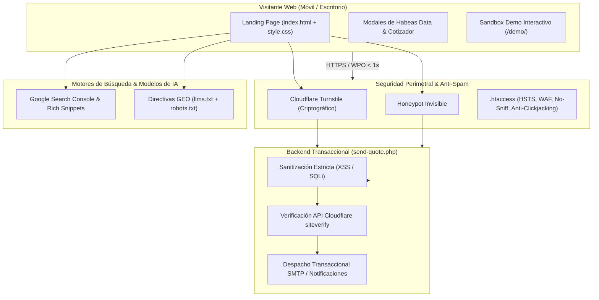

# 🚀 LoNet Solutions | Arquitectura Web de Alto Rendimiento & SEO Showcase

 

### 🌟 Plataforma Web Corporativa, Arquitectura Jamstack & Motor de Cotizaciones Inteligente
**Desarrollado y Posicionado por Luis Miguel Pérez Iglesias & Óscar Vásquez**

[🌐 Visitar Sitio Web Oficial](https://lonetsolutions.com/) • [🚀 Panel Demo Interactivo](https://lonetsolutions.com/demo/) • [📰 Hemeroteca Demo](https://lonetsolutions.com/demo/noticias.html) • [🏫 Portal Escolar Demo](https://lonetsolutions.com/demo/portal.html) • [💼 Solicitar Cotización](https://lonetsolutions.com/#contacto)

---

## 📌 Acerca de este Showcase

> [!IMPORTANT]
> Este repositorio es el **escaparate oficial y ficha técnica de ingeniería de software (*Showcase*)** del sitio web corporativo de **[LoNet Solutions](https://lonetsolutions.com)**.
> 
> El código fuente, controladores transaccionales de correo PHP, algoritmos de validación y módulos de seguridad son **propiedad intelectual privada y confidencial de LoNet Solutions**.

---

## 🏢 Visión General: LoNet Solutions

**LoNet Solutions** es una firma de desarrollo tecnológico y posicionamiento estratégico en internet con sede en Colombia. Fusiona la **ingeniería de software de alta exigencia (WPO, seguridad perimetral, arquitecturas ultraligeras)** con el **posicionamiento orgánico de vanguardia en Google (SEO), motores generativos de Inteligencia Artificial (GEO) y optimización de conversión de ventas (CRO)**.

* **Dominio Corporativo:** [https://lonetsolutions.com/](https://lonetsolutions.com/)
* **Canales de Atención:** WhatsApp Oficial `+57 301 7686592` | `contacto@lonetsolutions.com`
* **Cobertura:** Proyectos en Bogotá, Medellín, Cali, Barranquilla, Cartagena y a nivel internacional.

---

## 👥 Equipo Fundador & Liderazgo Técnico

* 💻 **Luis Miguel Pérez Iglesias** — *Lead Developer & Co-Fundador*  
  Especialista en arquitectura de software, desarrollo frontend y backend nativo de alto rendimiento, optimización extrema WPO (*Core Web Vitals* $<1\text{s}$), pasarelas de pago, sandboxes interactivos y código modular blindado contra ingeniería inversa.

* 📈 **Óscar Vásquez** — *Head of SEO & Marketing Digital & Co-Fundador*  
  Especialista en posicionamiento orgánico en Google, Search Console, Google Analytics 4, GEO (*Generative Engine Optimization* para IA), campañas publicitarias de alto retorno (Google Ads y Meta Ads) y analítica de embudos de conversión.

---

## ⚡ Pilares de Ingeniería y Arquitectura

### 1. 🛡️ Arquitectura "Zero-Database" y Blindaje Perimetral
* **Eliminación Total de Inyecciones SQL:** El portal prescinde de motores MySQL o bases de datos expuestas en el frontend corporativo, erradicando el vector #1 de vulnerabilidades en la web.
* **Escudo `.htaccess`:** Cifrado en tránsito SSL/TLS forzado (301), protección contra navegación de directorios (`Options -Indexes`), cabeceras HSTS (`Strict-Transport-Security`), `X-Frame-Options: SAMEORIGIN` (anti-clickjacking), `X-Content-Type-Options: nosniff` y bloqueo directo a archivos sensibles (`.git`, `.env`, `.log`, `.sql`).

### 2. ⚡ Rendimiento Extremo WPO (*Web Performance Optimization* $< 1\text{s}$)
* **Cero Frameworks Bloatware:** Construido en Vanilla JavaScript nativo y CSS3 puro con variables dinámicas, logrando un *Time to First Byte (TTFB)* ultra bajo.
* **Formatos de Imagen de Nueva Generación:** Activos visuales optimizados en **WebP** y SVG con dimensiones exactas asignadas para un *Cumulative Layout Shift (CLS)* de `0.000`.
* **Carga Asíncrona de Tipografías:** Conexión anticipada (`preconnect`) a Google Fonts y precarga no bloqueante de fuentes Outfit y Plus Jakarta Sans.

### 3. 🤖 Escudo Anti-Spam Criptográfico (Cloudflare Turnstile & Honeypot)
* **Cloudflare Turnstile:** Verificación de usuario humano no intrusiva con validación criptográfica en backend mediante consulta HTTPS segura a la API oficial de Cloudflare (`siteverify`).
* **Trampa Honeypot Invisible:** Atrapa y descarta en silencio envíos de spambots automatizados sin degradar la experiencia de usuario.
* **Sanitización Transaccional (`send-quote.php`):** Desinfección estricta de todos los campos mediante `strip_tags()`, `filter_var(..., FILTER_VALIDATE_EMAIL)` y `htmlspecialchars(..., ENT_QUOTES, 'UTF-8')`.

### 4. ⚖️ Cumplimiento Legal Habeas Data (Ley 1581 de 2012 de Colombia)
* **Página Legal de 12 Artículos:** [`politica-de-tratamiento-de-datos.html`](https://lonetsolutions.com/politica-de-tratamiento-de-datos.html) ajustada a los lineamientos de la Superintendencia de Industria y Comercio (SIC) y el Decreto 1377 de 2013.
* **Consentimiento Previo Trazable:** Checkbox de aceptación explícita con trazabilidad en la notificación transaccional enviada tanto al equipo como al cliente.
* **Modal In-Page:** Consulta inmediata del extracto de privacidad sin necesidad de abandonar el flujo del formulario de cotización.

### 5. 🔍 Estrategia de Búsqueda Avanzada: SEO, Google Site Name & GEO (IA)
* **Schema.org JSON-LD:** Marcado de datos enriquecidos estructurados tipo `ProfessionalService` y `WebSite` con nombres alternativos (`LoNet`, `LoNet Solutions Colombia`).
* **Google Site Name:** Integración con `<meta property="og:site_name" content="LoNet Solutions">` y favicons cuadrados 1:1 reglamentarios (48x48, 192x192, 512x512).
* **GEO (*Generative Engine Optimization*):** Archivo [`llms.txt`](https://lonetsolutions.com/llms.txt) con documentación estructurada para motores de IA como Gemini, Claude, ChatGPT y Perplexity.

### 6. 🎮 Entorno Demo Interactivo en Vivo (`/demo/`)
* **Suite Demo Completa en Sandbox:**
  1. **Panel Editorial Administrativo:** [https://lonetsolutions.com/demo/](https://lonetsolutions.com/demo/) (con 4 roles de acceso rápido en 1 clic: Super Admin, Administrador, Docente y Estudiante).
  2. **Hemeroteca Institucional Interactiva:** [https://lonetsolutions.com/demo/noticias.html](https://lonetsolutions.com/demo/noticias.html) (sincronizada en tiempo real con las publicaciones del panel, filtros y buscador predictivo).
  3. **Portal Web Institucional Demo:** [https://lonetsolutions.com/demo/portal.html](https://lonetsolutions.com/demo/portal.html) (noticias de portada, cintillo breaking news, reproductor de himno institucional y ventanilla PQRS interactiva).
* **Rebranding Ficticio Educativo:** Entorno ambientado con identidad simulada ("Colegio Siglo XXI"), resguardando la privacidad de clientes reales y permitiendo pruebas libres.
* **Soporte Nativo de Modo Oscuro:** Integración de conmutador de tema claro/oscuro en todas las vistas de la demo y el portal.
* **Aislamiento Total:** Todo opera en el `localStorage` del navegador con botón para **Restablecer Datos Demo**, permitiendo que prospectos y directivos evalúen la solución con cero riesgo para datos reales.
* **Protección de Código Fuente:** Compilación de producción con Terser (3 pasadas de compresión sin comentarios) y DOM HTML libre de comentarios de desarrollo.

---

## 🏛️ Diagrama de Arquitectura del Sistema

---

## 💼 Portafolio de Creaciones Propietarias de LoNet Solutions

1. **[Sistema Editorial & CMS de Noticias Institucional](https://github.com/Luisigle97/modulo-noticias-cms-showcase):**
   Plataforma editorial con autenticación criptográfica PBKDF2, RBAC, Modo Pánico y auditoría histórica. Caso de éxito: [I.E. Juan José Nieto](https://juanjosenietocartagena.edu.co/noticias.html).
2. **[Portal Web Institucional Nietista](https://github.com/Luisigle97/Pagina-Web-Juan-Jose-Nieto-Cartagena-showcase):**
   Ventanilla única de PQRS digital, directorio de personal en tiempo real y cumplimiento de normatividad MEN.
3. **Tiendas Virtuales E-Commerce de Alta Conversión:**
   Integración con pasarelas de pago colombianas e internacionales, checkout sin fricción y analítica de carritos.
4. **Desarrollo de Software Web a Medida:**
   Sistemas de gestión operativa, intranets corporativas y soluciones digitales escalables.

---

## 📞 Canales de Contacto Comercial

* **Sitio Web Oficial:** [https://lonetsolutions.com/](https://lonetsolutions.com/)
* **WhatsApp Corporativo:** [+57 301 7686592](https://wa.me/573017686592)
* **Correo de Cotizaciones:** `contacto@lonetsolutions.com` / `solutionslonet@gmail.com`
* **Ubicación:** Cartagena de Indias, Colombia (operación en toda Colombia e internacional).

---

## 📄 Licencia de Propietario

Copyright (c) 2026 **[LoNet Solutions](https://lonetsolutions.com)**. Todos los derechos reservados.

El código fuente, arquitectura de software, marcas, logotipos y componentes visuales de este proyecto son propiedad intelectual exclusiva de **LoNet Solutions**. Queda prohibida la reproducción, distribución, modificación, copia o descompilación no autorizada de este software sin el consentimiento previo, expreso y por escrito de sus titulares. Consulta el archivo [LICENSE](LICENSE) para más detalles.
